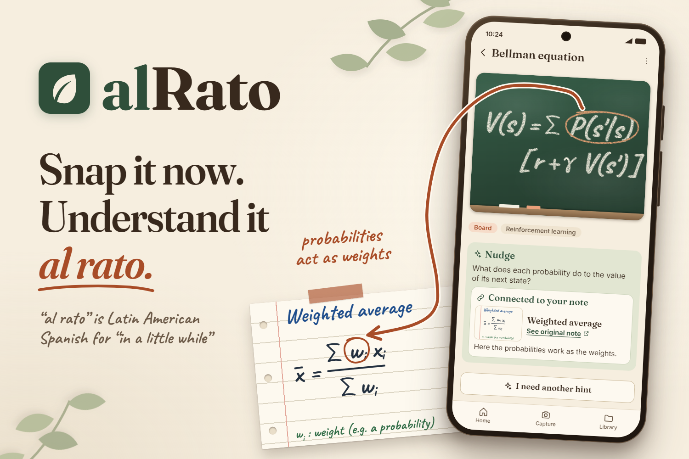
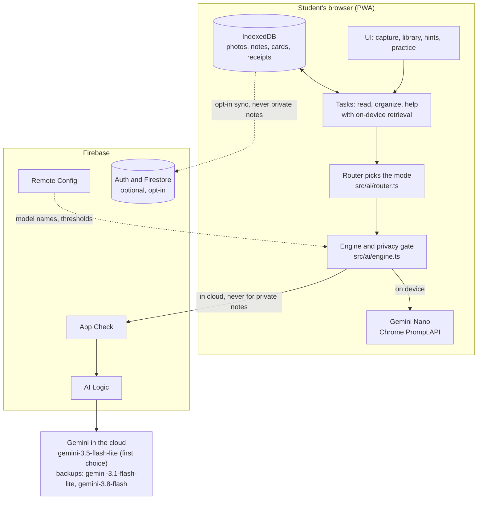

# alRato

**Snap the board in two seconds, stay in class, and understand it later.**

Students photograph the board and often never open the photo again. alRato ("al rato" is Latin American Spanish for "in a little while") keeps that two-second habit and does the rest afterward: it reads the photo, organizes it, coaches the student through a Socratic hint ladder, connects the new note to one they already have, and schedules spaced practice.

**Try it:** [alrato-e3564.web.app](https://alrato-e3564.web.app) · **Watch the demo:** video coming soon (3 minutes, in English)

| | |
|---|---|
| **The problem** | A photo of the board feels like studying. Nothing happens until someone opens it again. |
| **The value** | The photo turns into hints, a link to what you already know, and practice scheduled for later. |
| **What is non-obvious** | The model extracts what each note *teaches* and what it *needs* as prior knowledge. On-device retrieval matches needs against teaches, so a Bellman equation exercise connects to the student's old weighted-average note, because probabilities act as weights, even though the two notes share almost no words. |
| **Firebase AI Logic** | Each task picks its own SDK inference mode in [`src/ai/router.ts`](src/ai/router.ts). Private notes use `ONLY_ON_DEVICE`. Reading handwriting and math, and organizing a note, use `PREFER_IN_CLOUD`. Hints use `PREFER_ON_DEVICE`. With no route available, the note waits and resumes by itself. |
| **Proof on every answer** | A receipt shows the real `response.inferenceSource` from the SDK, the bytes sent and the latency. |
| **An SDK behavior we guard against** | In SDK 13.4, `ONLY_ON_DEVICE` in a browser without the Prompt API silently goes to the cloud. alRato refuses that call before the SDK runs: see `assertOnDevicePossible` in [`src/ai/engine.ts`](src/ai/engine.ts) and [`tests/engine.test.ts`](tests/engine.test.ts). |

**Read next:** [How it uses Firebase AI Logic](#how-firebase-ai-logic-is-used) · [Privacy model](#privacy-model) · [Testing instructions for judges](#testing-instructions-for-judges) · [Architecture](docs/ARCHITECTURE.md) · [Decision record](docs/ADR-001-hybrid-inference.md)

<p align="center">
  
</p>

## The problem, and what the research says

Phones made it easy to capture a board and just as easy to never see it again. Before designing anything, we read what is known about that moment.

- **The photo is not the learning.** Results on photographing lecture slides are mixed. In-person experiments found it impairs memory for the slide content (Trego et al., 2025), and longhand notes beat photos for a recorded lecture (Wong & Lim, 2023), while online experiments found a benefit (Ditta et al., 2023; Trego et al., 2025). We do not claim that photos help. In alRato a photo is only a promise to come back.
- **Recalling beats rereading.** On delayed tests, students who practiced recalling a text remembered substantially more than students who restudied it (Roediger & Karpicke, 2006).
- **Spacing works, and the best gap grows with how long you need to remember** (Cepeda et al., 2006). Of ten study techniques reviewed by Dunlosky et al. (2013), practice testing and distributed practice were the only two rated high utility.
- **Prior knowledge helps when it is activated, relevant and consistent with the new material** (Brod, 2021). It does not help automatically: a meta-analysis of 8,776 effect sizes found that prior knowledge strongly predicts later knowledge but, on average, not how much a student gains (Simonsmeier et al., 2022). That is why alRato points to one specific earlier note instead of saying "review the basics".
- **Unguarded AI help can backfire.** In a field experiment with nearly a thousand high school math students, unrestricted GPT-4 raised practice grades by 48% and lowered grades on a later unassisted exam by 17%. A version with learning safeguards largely removed that harm (Bastani et al., 2025). That is why alRato makes the student climb a ladder instead of showing the answer.

alRato is designed around these findings. It has not been evaluated with students yet, so we make no claim about learning gains. Full references are at the [end of this file](#references).

## What it does

1. **Snap.** Use the camera or the gallery, add an optional line of context, and optionally mark the note **Keep on this device**. The photo is saved locally and the app returns at once, so the student can look back at the board.
2. **Read and organize, later.** A background queue transcribes the photo, with math in LaTeX, then labels it: kind, title, subject, topic, what it teaches and what it needs. If no route is available, the note waits and continues by itself.
3. **Help, one rung at a time.** For an exercise the student climbs four rungs: nudge, hint, first step, full solution. This follows the classic tutoring sequence of pointing, teaching and bottom-out hints (VanLehn, 2006). Other notes get key ideas, an explanation or an answer to the student's doubt. The full solution is shown like an animated math video: at the top of a dark board the main equation transforms from one step to the next (symbols that stay glide to their new place, new ones are written in colour, the rest fade), and below it each step is written one symbol at a time. When the exercise is a function or an equation in *x*, the model also names the function; the app draws its graph with the answers marked, and then **checks those answers on the device, without any model**, by putting them into the function ("Checked on this device: f(−3) = 0 · f(1) = 0"). That is the hybrid split for solving: the cloud writes the long reasoning, the device verifies it and gives the everyday hints. The function is read by a small parser in [`src/core/plot.ts`](src/core/plot.ts), never evaluated as code, and only the last rung may draw one, because a graph shows the answer.
4. **Connect.** An answer can link to one earlier note under **Connected to your note**, with one sentence that starts from what the student already knows.
5. **Practice.** Help can propose a short question. The student tries it, reveals the answer, rates themselves, and the card comes back on a Leitner-style schedule of 1, 3, 7, 16 or 35 days.

With **optional sync**, a student can snap the board on a phone, which has no local model, and study it on a laptop with Gemini Nano. Sync is off until the student turns it on, and private notes never sync.

## How Firebase AI Logic is used

Every model call in alRato goes through Firebase AI Logic. Two files hold the design:

- **[`src/ai/router.ts`](src/ai/router.ts)** is the policy. `decideRoute()` picks an SDK inference mode for each task, or decides that the task must wait.
- **[`src/ai/engine.ts`](src/ai/engine.ts)** is the execution. It builds the hybrid model, runs the privacy gate, calls `generateContent`, reads `response.inferenceSource`, falls back when needed and writes the receipt.

```ts
// src/ai/engine.ts, simplified
const model = getGenerativeModel(ai, {
  mode, // chosen per task by decideRoute()
  inCloudParams: { model, systemInstruction, generationConfig: { responseMimeType: 'application/json', responseSchema } },
  onDeviceParams: {
    createOptions: { expectedInputs, expectedOutputs, initialPrompts: [{ role: 'system', content: system }] },
    promptOptions: { responseConstraint: responseSchema },
  },
});
const result = await model.generateContent(parts);
const source = result.response.inferenceSource; // ON_DEVICE or IN_CLOUD, shown on the receipt
```

What we use from the platform:

- **Hybrid inference** with all four modes, on the Gemini Developer API backend (`GoogleAIBackend`).
- **One JSON Schema for both routes** ([`src/ai/schemas.ts`](src/ai/schemas.ts)): `responseSchema` in the cloud and `responseConstraint` on Gemini Nano, so the app handles one shape.
- **Text and image prompts** on both routes.
- **`initializeDeviceModel()`** with a progress callback, started from a button because Chrome requires a user gesture for the download.
- **App Check** with reCAPTCHA Enterprise ([`src/firebase/app.ts`](src/firebase/app.ts)). Without it, the cloud route stays closed.
- **Remote Config** ([`src/firebase/remoteConfig.ts`](src/firebase/remoteConfig.ts)) for model names and routing thresholds, so a retired model can be swapped without a rebuild.

### Which task uses which mode, and why

`decideRoute()` evaluates these rules in order. The first match wins.

| # | Situation | Inference mode | Why | Receipt reason |
|---|---|---|---|---|
| 1 | Private note, local model ready | `ONLY_ON_DEVICE` | The student said it stays here | `private_note` |
| 2 | Private note, no local model | No call: waits in the queue | It must never fall back to the cloud | `private_needs_device` |
| 3 | No usable cloud (offline, not configured, or daily cap reached), local model ready | `ONLY_ON_DEVICE` | The device is the only route | `offline`, `no_cloud`, `cloud_cap` |
| 4 | No usable cloud, no local model | No call: waits in the queue | It resumes when a route opens | `offline_no_model`, `cloud_unavailable`, `cloud_cap_no_model` |
| 5 | Online, no local model (every phone today) | `PREFER_ON_DEVICE` | Runs in the cloud now, and picks up a local model as soon as one is ready | `no_local_model` |
| 6 | Student chose **Device first** | `PREFER_ON_DEVICE` | The student's call | `user_local` |
| 7 | Student chose **Best quality** | `PREFER_IN_CLOUD` | The student's call | `user_quality` |
| 8 | Reading a photo on paid mobile data | `PREFER_ON_DEVICE` | Saves the student's data | `save_data` |
| 9 | Reading a photo on a normal connection | `PREFER_IN_CLOUD` | Handwriting and math need the stronger vision model | `vision_quality` |
| 10 | Organizing a note, when the cloud is allowed | `PREFER_IN_CLOUD` | The kind and the links decide what the student sees next, so the stronger model does it | `classify_quality` |
| 11 | The full worked solution (last rung of the hint ladder), when the cloud is allowed | `PREFER_IN_CLOUD` | Long reasoning, asked for once per exercise; the device then checks its answers without any model | `solution_quality` |
| 12 | Input over 3,500 characters | `PREFER_IN_CLOUD` | Long prompts go to the model with more room | `long_input` |
| 13 | Hints, normal input | `PREFER_ON_DEVICE` | Short, frequent and interactive: no network, no API cost | `everyday_local` |

If an on-device call fails or returns unusable output and the note is not private, the engine retries with `ONLY_IN_CLOUD` (`device_failed_fallback`). The SDK does not do this by itself once it has committed to the device.

### Architecture



The full design, with sequence and state diagrams, is in [docs/ARCHITECTURE.md](docs/ARCHITECTURE.md). The reasoning behind the split between client and cloud is in [docs/ADR-001-hybrid-inference.md](docs/ADR-001-hybrid-inference.md).

## Privacy model

**Stored on the device.** Photos, notes, hints, practice cards and usage history live in IndexedDB. The app needs no server of ours, and nothing is synced unless the student opts in.

**Cloud AI asks first.** Nothing goes to the cloud until the student agrees. The first time a note needs the cloud, a short sheet explains in plain words what the free tier of the Gemini Developer API means: what is sent, that Google may use it to improve its products and people may read it, the age limit and the regions where it is not offered. Declining keeps everything on the device: notes run on Gemini Nano when it is there and otherwise wait. The choice can be changed at any time under **Your AI > Cloud AI**.

**What can leave the device.** Only for notes that are not private, only after that consent, and only what the task needs:

| Task | Sent to the cloud route |
|---|---|
| Read | The photo (a JPEG of at most 1600 px), the instructions and the optional comment |
| Organize | The transcription (up to 2,400 characters) and the comment |
| Help | The note, the hints already given, and short snippets (260 characters each) of up to three related notes that are not private |

**Private notes** are protected in six places:

1. The router only ever gives them `ONLY_ON_DEVICE`, or makes them wait.
2. `assertOnDevicePossible()` refuses the call before the SDK runs if the browser has no Prompt API.
3. If a private answer ever reported a source other than on-device, the engine would discard it.
4. A failed private call is never retried in the cloud.
5. `retrievalPool()` in [`src/ai/help.ts`](src/ai/help.ts) keeps private notes out of any prompt that could reach the cloud.
6. If a note is marked private while a model is working on it, the queue in [`src/core/queue.ts`](src/core/queue.ts) discards that answer and sends the note back to wait under the private rule, so nothing more about it goes out.

**Optional sync** ([`src/firebase/sync.ts`](src/firebase/sync.ts)) is off by default and needs Google sign-in. It uploads each non-private note's photo, thumbnail, text, comment and labels to the student's own Firestore space. Hints, practice and receipts stay on the device. Private notes cannot be serialized for upload, [`firestore.rules`](firestore.rules) rejects any document marked private, and marking a synced note private deletes its cloud copy.

### The SDK behavior we guard against

The Firebase documentation says that `ONLY_ON_DEVICE` throws when no on-device model is available. In SDK 13.4 that holds only when Chrome's Prompt API exists. In a browser without it, the SDK creates no Chrome adapter, and `callCloudOrDevice` starts like this:

```js
// node_modules/@firebase/ai/dist/esm/index.esm.js (13.4.0)
async function callCloudOrDevice(request, chromeAdapter, onDeviceCall, inCloudCall) {
    if (!chromeAdapter) {
        return { response: await inCloudCall(), inferenceSource: InferenceSource.IN_CLOUD };
    }
```

So on a phone, an app that trusts the mode would send a "device only" note to the cloud with no error. [`tests/engine.test.ts`](tests/engine.test.ts) pins this behavior against the real SDK and proves that alRato's gate stops it, so the test will flag any change in a future SDK version.

**What the promise covers.** "Keep on this device" is a promise from the moment of capture. Turning it on later cannot recall what already left, including a request that is already on its way. Its answer is discarded and nothing more is sent (see [Known limitations](#known-limitations)).

## Features

- Capture from camera or gallery in one tap, with optional context and a privacy switch
- Cloud AI only after the student agrees to a plain-words notice; declining keeps every note on the device
- Offline-tolerant queue with automatic retries that resumes on reconnect, when a model becomes ready, or when the app is reopened
- Transcription with math rendered by KaTeX, always editable by the student
- Automatic organization by kind, subject and topic; labels the student sets are never overwritten
- Library search that ignores case and accents
- Four-rung Socratic hint ladder for exercises
- "Connected to your note" links; the model can cite only notes the app offered it
- Spaced practice with self-rated recall
- A receipt on every AI answer, and a **Your AI** screen with on-device and cloud counts
- Route preference: **Smart**, **Device first** or **Best quality**
- English and Spanish, in the interface and in the model's answers
- Installable PWA that opens offline after the first visit
- A single button to erase everything on the device
- Optional Google sign-in with Firestore sync between devices, off by default; private notes never sync

## Setup

You need Node 22 and npm 10.

### 1. Run it locally, no Firebase project needed

```bash
npm install
npm run dev
```

Open the local URL Vite prints. Capture, library, practice and on-device inference work without a backend. Cloud tasks wait in the queue, and the badge says **AI not connected**.

### 2. Create a Firebase project

1. In the [Firebase console](https://console.firebase.google.com/), create a project. Google Analytics is not needed.
2. Register a **Web app** and keep its config values for step 5.

### 3. Turn on Firebase AI Logic with the Gemini Developer API

1. Go to **AI Services > AI Logic** and click **Get started**.
2. Choose the **Gemini Developer API**, which has a no-cost tier, and finish the guided setup. It enables the required APIs and enforces App Check for AI Logic.

Do not add a Gemini API key to the app or to this repository. Firebase AI Logic does not need one in client code.

### 4. Set up App Check

1. **Create a site key.** In the Google Cloud console, open the reCAPTCHA page (listed as **Fraud Defense**) for your project, enable the API if prompted, and create a **Web**, score-based key with the checkbox challenge off. Add your production domains. Do not add `localhost`.
2. **Register the app.** In Firebase, go to **Security > App Check > Apps**, register the web app with **reCAPTCHA Enterprise**, and paste the site key.
3. **Get a debug token for local development.** Run `npm run dev` with your config in place, open the browser console and copy the value after `AppCheck debug token:`. In **Security > App Check > Apps**, open your app's menu, choose **Manage debug tokens** and register it. Keep this token private and never commit it.
4. **Confirm enforcement.** In **Security > App Check > APIs**, the Firebase AI Logic row must say **Enforced**.

### 5. Create `.env.local`

```bash
cp .env.example .env.local
```

Fill in the Firebase config values, `VITE_RECAPTCHA_ENTERPRISE_KEY`, and optionally `VITE_APPCHECK_DEBUG_TOKEN` for local development. `.env.local` is git-ignored.

### 6. Remote Config (optional)

The app ships with safe defaults, so this step is optional. To change them from the console, deploy [`remoteconfig.template.json`](remoteconfig.template.json):

| Parameter | Default | Purpose |
|---|---|---|
| `model_vision` | `gemini-3.5-flash-lite,gemini-3.8-flash,gemini-4-hydrogen` | Cloud models for reading photos. The first is preferred, the rest are backups |
| `model_text` | `gemini-3.5-flash-lite,gemini-3.1-flash-lite,gemini-3.8-flash` | Cloud models for organizing and hints. The first is preferred, the rest are backups |
| `long_input_chars` | `3500` | Above this, text tasks prefer the cloud |
| `daily_cloud_cap` | `40` | Cloud calls per browser per day before the device or the queue takes over |

### 7. Firestore and Google sign-in (optional)

Only needed for opt-in sync.

1. In the console, create a **Firestore** database and enable **Authentication > Sign-in method > Google**.
2. Under **Authentication > Settings > Authorized domains**, make sure your Hosting domain is listed.
3. Deploy the security rules in [`firestore.rules`](firestore.rules) (see step 8). They limit each student to their own data and reject any document marked private.

### 8. Deploy to Firebase Hosting

[`firebase.json`](firebase.json) is already configured.

```bash
npm run build
npx firebase-tools login
npx firebase-tools use --add
npx firebase-tools deploy --only hosting,remoteconfig
# with opt-in sync enabled:
npx firebase-tools deploy --only firestore
```

Then add your `*.web.app` and `*.firebaseapp.com` domains to the reCAPTCHA key from step 4.

## Android app (APK)

alRato also ships as an Android app. It is a [Trusted Web Activity](https://developer.chrome.com/docs/android/trusted-web-activity) built with Bubblewrap from [`android/twa-manifest.json`](android/twa-manifest.json): Chrome opens the hosted PWA full screen, and [`public/.well-known/assetlinks.json`](public/.well-known/assetlinks.json) proves the app and the site belong together, so there is no address bar. It is the same app, the same code and the same privacy rules, and it updates when the site is deployed.

**How the hybrid AI behaves on a phone.** The router is the same. Cloud calls go through Firebase AI Logic with App Check, exactly as on the web. Gemini Nano runs on the phone only if Chrome on that phone offers its on-device Prompt API; where it does not, which is most phones today, a public note uses the cloud after consent and a private note waits on the device (rows 4 and 5 of the routing table). Every answer's receipt says which route was taken. The device-side check of a full solution ([`src/core/verify.ts`](src/core/verify.ts)) needs no model, so it runs on every phone.

**Install on a phone.** Copy `app-release-signed.apk` to the phone and open it; Android asks once to allow installs from that source.

**Build it** (JDK 17 and the Android SDK; the signing key is kept outside the repository):

```bash
npm install --prefix ./.local/bubblewrap @bubblewrap/cli
cd android
node ../.local/bubblewrap/node_modules/@bubblewrap/cli/bin/bubblewrap.js update --skipVersionUpgrade
node ../.local/bubblewrap/node_modules/@bubblewrap/cli/bin/bubblewrap.js build --skipPwaValidation
```

For Google Play, upload the `.aab` and add Play App Signing's SHA-256 fingerprint to `assetlinks.json`, next to the one already there.

## Enable and check Gemini Nano in Chrome

On-device inference through Firebase AI Logic needs **Chrome on desktop**. Chrome on Android and iOS does not have it yet, so phones take the cloud route.

| Requirement | Value |
|---|---|
| Browser | Chrome 148 or later (the Prompt API shipped to the web in 148; Firebase AI Logic needs 139 or later) |
| Languages | English and Spanish, among others, from Chrome 149 |
| OS | Windows 10 or 11, macOS 13+, Linux, or ChromeOS on Chromebook Plus |
| Storage | At least 22 GB free on the volume that holds the Chrome profile |
| Hardware | A GPU with more than 4 GB of VRAM, or 16 GB of RAM with at least 4 CPU cores |
| Network | An unmetered connection for the first download only |

1. Update Chrome. Firebase's hybrid guide also asks you to set `chrome://flags/#prompt-api-for-gemini-nano-multimodal-input` to **Enabled** and relaunch. Do this if `LanguageModel` is undefined or image input reports `unavailable`.
2. Open alRato, go to **Your AI** and click **Download on-device AI**. The button appears when Chrome reports the model as downloadable.
3. Check it in the DevTools console, using the options alRato asks for:

   ```js
   await LanguageModel.availability({
     expectedInputs: [{ type: 'text', languages: ['en', 'es'] }, { type: 'image' }],
     expectedOutputs: [{ type: 'text', languages: ['en'] }],
   });
   // "available" means the model is ready.
   ```

4. For more detail, open `chrome://on-device-internals`. When the model is ready, the badge in the app says **On-device AI ready**.

## Testing instructions for judges

### The five-minute path

1. Open the hosted app at [alrato-e3564.web.app](https://alrato-e3564.web.app). English is the default unless your browser is set to Spanish. You can switch under **Your AI > Language**.
2. On the home screen, click **Try it with sample notes**. Two ready-made notes appear: *Weighted average* and *Ohm's law*.
3. Click **Add the Bellman board**. This creates a new photo of a board that goes through the real AI pipeline. On a browser without Gemini Nano, a short notice explains the cloud route first: choose **I am 18+ and I agree** to continue, or keep everything on the device.
4. Wait for **Reading your photo…** and **Organizing your note…** to finish. Each step leaves a receipt.
5. Click **Give me a hint**, then **I need another hint**. If the model labeled the note as something other than an exercise, set its type under **⋮ > Edit labels > Type > Exercise**, or use the button shown.
6. Look for **Connected to your note**, linking to *Weighted average*.
7. Click any receipt to see why that route was chosen and which model answered.
8. Click **Practice**, try the question, reveal the answer and rate yourself.

### See each route

| Route | How to trigger it | What you should see |
|---|---|---|
| **Cloud** | Use a phone, or any browser without Gemini Nano | Receipt: **In the cloud**, with the size sent. DevTools > Network shows a `generateContent` request |
| **On-device** | Desktop Chrome with Gemini Nano. Ask for a hint | Receipt: **On this device · nothing sent**. No `generateContent` request |
| **Private** | Turn on **Keep on this device** before taking the photo | With Nano: **On this device**. Without Nano: the note waits with "Private note. It stays here until this device has a local AI model." In both cases, no `generateContent` request |
| **Offline, with Nano** | DevTools > Network > **Offline**, then ask for a hint | **On this device**. Open the receipt: "You are offline, so Gemini Nano handled it right here." |
| **Offline, no model** | Turn on airplane mode on a phone and take a photo | "Saved. alRato will read it when you are back online." Reconnect and it finishes by itself |
| **Paid data, with Nano** | Throttle the network to **3G** in DevTools, then add a photo | Open the receipt: "You are on mobile data, so the photo was processed here to save it." |
| **Student preference** | **Your AI >** Device first or Best quality | The receipt reason changes to match |

The rules behind this table are unit-tested in [`tests/router.test.ts`](tests/router.test.ts). If you cannot get Gemini Nano on your machine, [`tests/engine.test.ts`](tests/engine.test.ts) exercises the on-device path through the real SDK against a stubbed Prompt API.

## Run the tests

```bash
npm test            # Vitest
npx tsc --noEmit    # type check
npm run test:e2e    # the production build in the installed Chrome, phone and desktop, English and Spanish
```

The end-to-end script, [`scripts/e2e.mjs`](scripts/e2e.mjs), builds the app with obviously fake Firebase values, serves it with `vite preview` and drives Chrome over the DevTools protocol with real taps and clicks. The Firebase SDK, App Check, the service worker and IndexedDB all run for real. The network answers are canned on purpose: Chrome's DNS is switched off, the script answers the Gemini, App Check and Remote Config endpoints itself and counts every Gemini request, and a fake `window.LanguageModel` stands in for Gemini Nano in the on-device journeys. So it proves how the product behaves around the models (routes, receipts, privacy, consent, offline, failures, races, accessibility and translations), never how good a model's answers are. Screenshots go to `.local/shots`. Set `CHROME_PATH` if Chrome is not in its default Windows location.

The tests run the browser build of the real Firebase AI Logic SDK with `fetch` and Chrome's `LanguageModel` stubbed, so no test calls a real service. They cover the routing policy, the privacy gate, the SDK behavior above, fallbacks, the offline queue, retrieval, scheduling, output validation and sync. The Firestore security-rule tests in [`tests/sync.rules.test.ts`](tests/sync.rules.test.ts) run only against the local emulator and are skipped otherwise. The command is at the top of that file.

## Built during the contest

alRato was written from scratch during the contest period, starting from an empty folder. That includes the React app, the hybrid router and engine, the privacy gate, the offline queue, teaches/needs retrieval, the hint ladder, spaced practice, the receipts, the English and Spanish interface, the tests, the Firebase configuration and this documentation. The only pre-existing code is the third-party libraries listed below.

### Built with Claude Code

alRato is built with **[Claude Code](https://claude.com/claude-code)**, an AI coding assistant. It was used throughout the project, under the direction of the project's author, to write and test the code, review it for bugs and draft this documentation.

## Third-party libraries

| Library | Version | License | Used for |
|---|---|---|---|
| [Firebase JS SDK](https://github.com/firebase/firebase-js-sdk) | 13.4.0 | Apache-2.0 | AI Logic, App Check, Remote Config, optional Auth and Firestore |
| [React](https://react.dev/) and React DOM | 19.3.1 | MIT | UI |
| [Dexie](https://dexie.org/) and dexie-react-hooks | 4.4.7, 4.4.0 | Apache-2.0 | IndexedDB storage |
| [KaTeX](https://katex.org/) | 0.19.1 | MIT | Math rendering |
| [Fraunces](https://fontsource.org/fonts/fraunces), [Inter](https://fontsource.org/fonts/inter), [Caveat](https://fontsource.org/fonts/caveat) via Fontsource | 5.3.0 | OFL-1.1 | Typefaces |
| [Vite](https://vite.dev/) and @vitejs/plugin-react | 8.3.8, 6.3.0 | MIT | Build |
| [vite-plugin-pwa](https://github.com/vite-pwa/vite-plugin-pwa) with Workbox | 2.0.0, 7.4.1 | MIT | Service worker and offline shell |
| [TypeScript](https://www.typescriptlang.org/) | 7.0.2 | Apache-2.0 | Type checking |
| [Vitest](https://vitest.dev/), [jsdom](https://github.com/jsdom/jsdom) | 5.1.1, 29.1.1 | MIT | Tests |
| [fake-indexeddb](https://github.com/dumbmatter/fakeIndexedDB) | 6.2.8 | Apache-2.0 | Tests |

Firebase, Gemini and Chrome are trademarks of Google LLC. alRato is an independent project and is not endorsed by Google.

## Known limitations

- **No learning evaluation yet.** The design follows published research, but alRato has not been tested with students, so we make no claim about learning gains.
- **The on-device path has run once, on a cloud machine.** Gemini Nano ran for real, on CPU only, in a free cloud virtual machine (4 cores, 16 GB RAM, Chrome 158 on Linux). The model took 152 seconds to download, and single runs took 4.3 s for a Spanish sentence, 3.2 s for JSON and 6.9 s for a short board image. On that run Gemini Nano filed the sample exercise as a formula in three of four tries, which is why organizing runs in the cloud when it is allowed. The student can change a note's type with one tap before hints start. The team's own computers and phones cannot run Gemini Nano, so there is no on-device measurement on a phone yet. <!-- MEASURE: on-device latency on a machine that meets the requirements -->
- **The free cloud tier is shared.** Gemini's free tier counts requests per Google Cloud project, so every visitor of the hosted app shares it. On Nov 24, 2026, Google AI Studio showed 500 requests a day each for gemini-3.5-flash-lite and gemini-3.1-flash-lite, and 20 a day for gemini-3.8-flash. When a model's daily quota is gone, a device stops asking that model until midnight Pacific time, and it answers on the device or waits. A cap of 40 cloud calls per browser per day keeps one heavy user from using up the shared quota.
- **Model quality is unmeasured.** We have no accuracy figures for reading handwriting and math on either route, or for how often teaches/needs extraction finds the right link. A connection appears only if the model names a matching prerequisite and agrees the note helps. <!-- MEASURE: transcription accuracy on real board photos, cloud vs Nano --> <!-- MEASURE: precision of "Connected to your note" on real notes -->
- **On-device needs desktop Chrome with capable hardware.** Phones use the cloud route, and a private note on a phone waits until a device with a local model is available.
- **Privacy starts at capture.** Marking an existing note private cannot recall what was already sent, including a request already on its way. Its answer is discarded and nothing more is sent. Set the switch before you take the photo.
- **Cloud hints can include related notes.** A hint on a non-private note may send short snippets of up to three related non-private notes. The receipt reports the size.
- **Sync is simple on purpose.** It keeps the most recent version of a note (last writer wins), and a note that cannot fit in one Firestore document after compression stays on the device.
- **Receipts count payload, not traffic.** `bytesSent` counts the prompt, instructions and encoded image. It leaves out HTTP headers and the JSON envelope.
- **The daily cloud cap is a client-side guard.** It protects the free quota from accidents. It is not a security boundary, and a fallback after weak on-device output can exceed it. App Check and backend quotas do the real enforcement.
- **App Check replay protection is off.** The app does not request limited-use tokens yet.
- **Mobile-data detection is best effort.** It relies on the Network Information API, which not every browser exposes.
- **Practice is self-rated**, and the Leitner intervals are sensible starting values, not fitted to data.

## References

- Bastani, H., Bastani, O., Sungu, A., Ge, H., Kabakcı, Ö., & Mariman, R. (2025). Generative AI without guardrails can harm learning: Evidence from high school mathematics. *Proceedings of the National Academy of Sciences, 122*(26), e2422633122. https://doi.org/10.1073/pnas.2422633122
- Brod, G. (2021). Toward an understanding of when prior knowledge helps or hinders learning. *npj Science of Learning, 6*(1), 24. https://doi.org/10.1038/s41539-021-00103-w
- Cepeda, N. J., Pashler, H., Vul, E., Wixted, J. T., & Rohrer, D. (2006). Distributed practice in verbal recall tasks: A review and quantitative synthesis. *Psychological Bulletin, 132*(3), 354–380. https://doi.org/10.1037/0033-2909.132.3.354
- Ditta, A. S., Soares, J. S., & Storm, B. C. (2023). What happens to memory for lecture content when students take photos of the lecture slides? *Journal of Applied Research in Memory and Cognition, 12*(3), 421–430. https://doi.org/10.1037/mac0000069
- Dunlosky, J., Rawson, K. A., Marsh, E. J., Nathan, M. J., & Willingham, D. T. (2013). Improving students' learning with effective learning techniques: Promising directions from cognitive and educational psychology. *Psychological Science in the Public Interest, 14*(1), 4–58. https://doi.org/10.1177/1529100612453266
- Roediger, H. L., & Karpicke, J. D. (2006). Test-enhanced learning: Taking memory tests improves long-term retention. *Psychological Science, 17*(3), 249–255. https://doi.org/10.1111/j.1467-9280.2006.01693.x
- Simonsmeier, B. A., Flaig, M., Deiglmayr, A., Schalk, L., & Schneider, M. (2022). Domain-specific prior knowledge and learning: A meta-analysis. *Educational Psychologist, 57*(1), 31–54. https://doi.org/10.1080/00461520.2021.1939700
- Trego, M. M., Soares, J. S., & Ditta, A. S. (2025). Snap & Write: Examining the effect of taking photos and notes on memory for lecture content. *Behavioral Sciences, 15*(5), 561. https://doi.org/10.3390/bs15050561
- VanLehn, K. (2006). The behavior of tutoring systems. *International Journal of Artificial Intelligence in Education, 16*(3), 227–265.
- Wong, S. S. H., & Lim, S. W. H. (2023). Take notes, not photos: Mind-wandering mediates the impact of note-taking strategies on video-recorded lecture learning performance. *Journal of Experimental Psychology: Applied, 29*(1), 124–135. https://doi.org/10.1037/xap0000375

## License

alRato is open source under the [Apache License 2.0](LICENSE).
