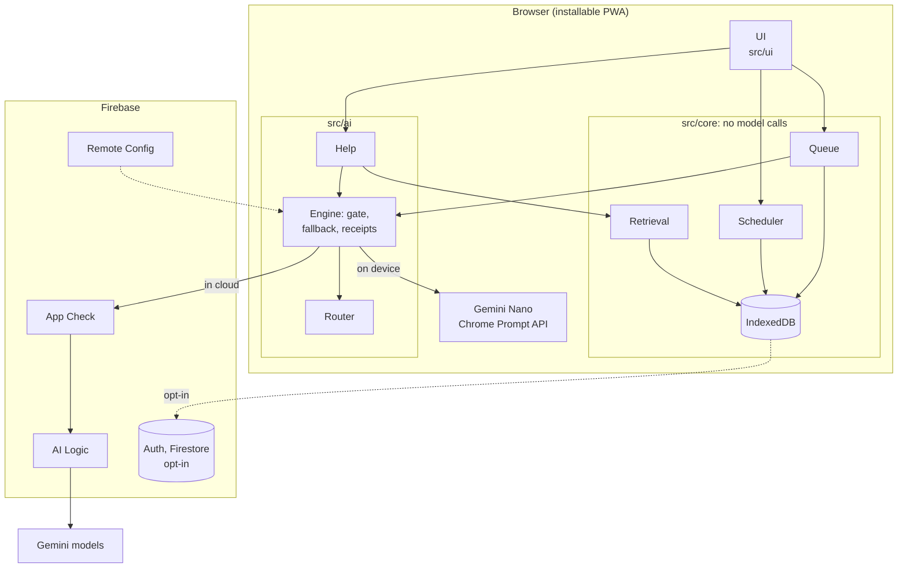
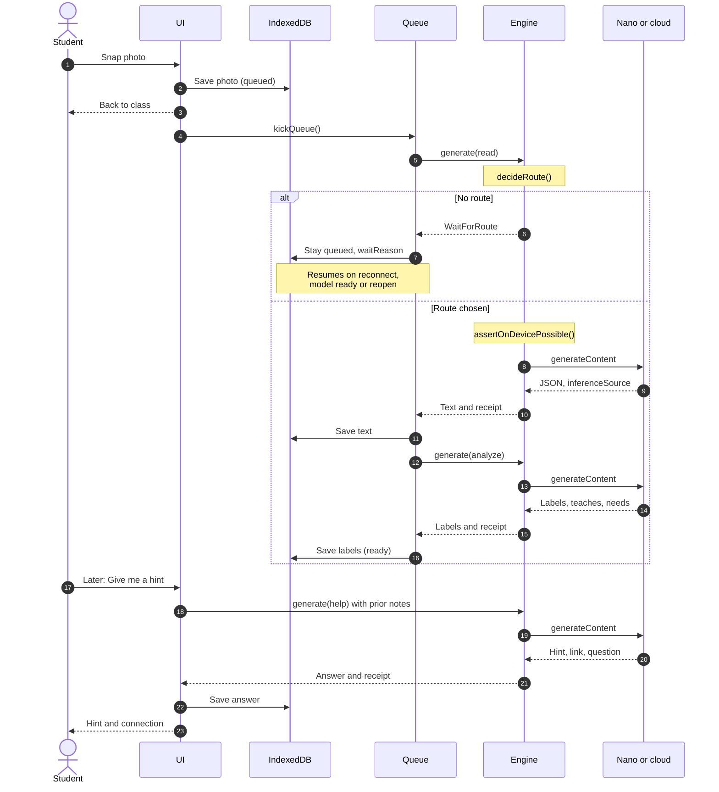
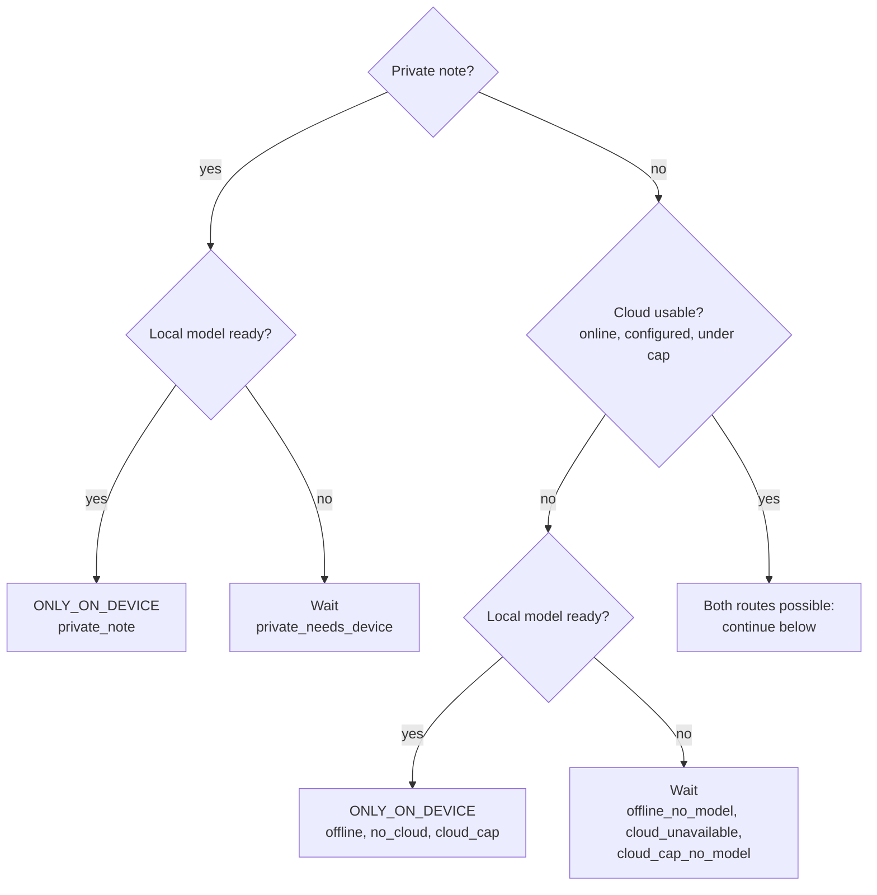
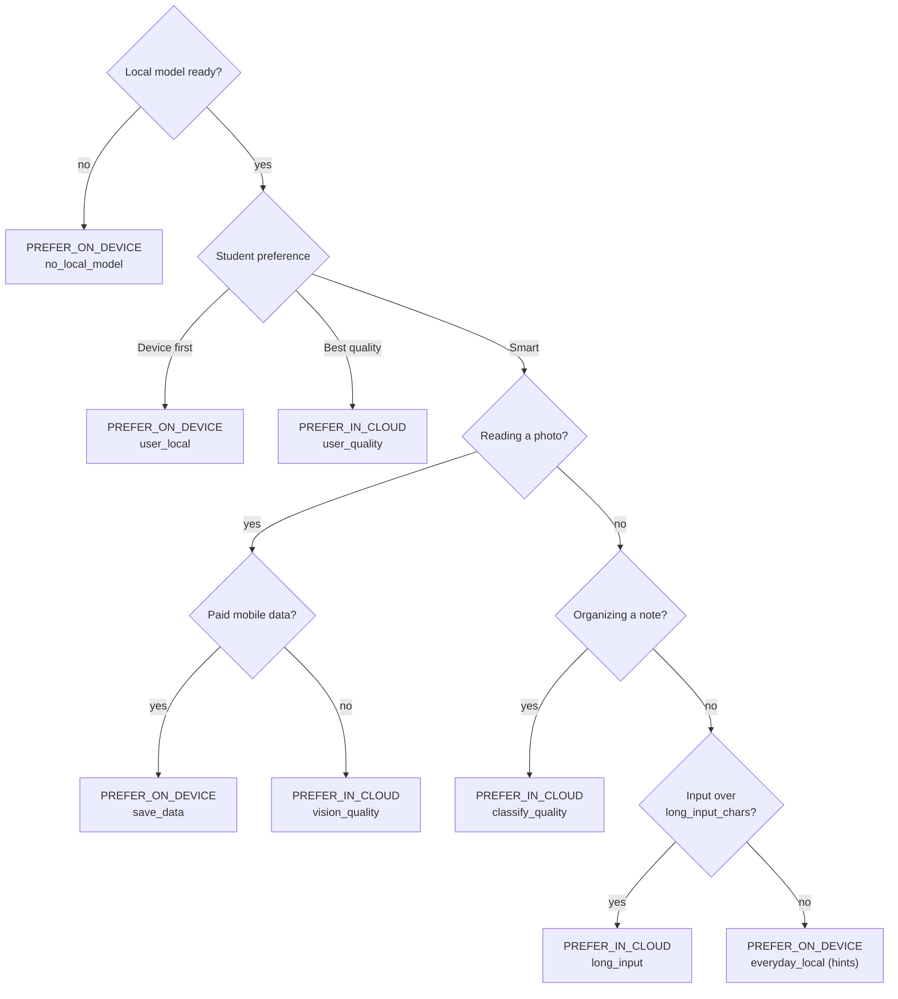
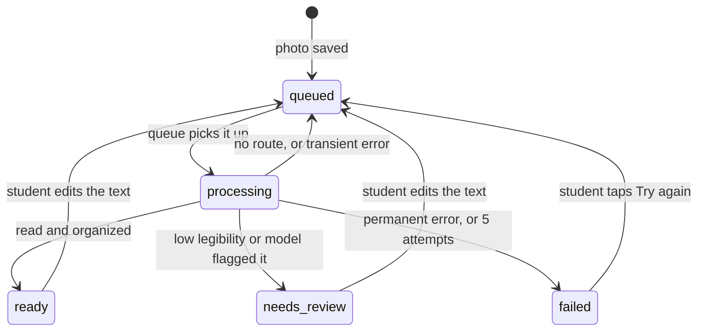

# alRato architecture

alRato is a client-side progressive web app. The student's browser holds the data, the queue, the routing policy and retrieval. Firebase provides the model endpoint, App Check, Remote Config and, if the student opts in, sign-in and sync. There is no application server of ours.

This document describes how the system works. The reasoning behind the split between client and cloud is in [ADR-001](ADR-001-hybrid-inference.md).

## Design rules

Four rules shaped the code. Each one is enforced in a specific place and covered by a test (see [Guarantees and where they are enforced](#guarantees-and-where-they-are-enforced)).

1. **Capture never waits for AI.** The photo is stored first. All model work happens later in a queue.
2. **A private note never leaves the device.** If the device cannot run it, it waits.
3. **The student's words win.** An edit invalidates any answer still in flight, and labels set by hand are never overwritten.
4. **Report what happened, not what was intended.** The receipt's source comes from the SDK's `response.inferenceSource`.

## System overview

## Module map

| Path | Responsibility |
|---|---|
| [`src/ai/router.ts`](../src/ai/router.ts) | `decideRoute()`: pure function that maps task and context to an inference mode or a wait reason |
| [`src/ai/engine.ts`](../src/ai/engine.ts) | Builds the hybrid model, runs the privacy gate, calls Firebase AI Logic, handles fallback, writes receipts |
| [`src/ai/device.ts`](../src/ai/device.ts) | Probes `LanguageModel.availability()` for text and image, tracks download progress, detects metered connections |
| [`src/ai/help.ts`](../src/ai/help.ts) | Hint ladder, retrieval pool, stale-answer check |
| [`src/ai/prompts.ts`](../src/ai/prompts.ts) | Versioned system prompts, ladder rules and input limits |
| [`src/ai/schemas.ts`](../src/ai/schemas.ts) | JSON Schemas shared by both routes |
| [`src/ai/validate.ts`](../src/ai/validate.ts) | Parses and bounds model output, drops citations to notes that were not offered |
| [`src/ai/errors.ts`](../src/ai/errors.ts) | Maps SDK and Prompt API errors to app failures; `WaitForRoute` |
| [`src/core/captures.ts`](../src/core/captures.ts) | Capture, edit, privacy, delete and card operations |
| [`src/core/queue.ts`](../src/core/queue.ts) | Read and organize pipeline, retries, recovery |
| [`src/core/retrieval.ts`](../src/core/retrieval.ts) | On-device ranking of prior notes, library search |
| [`src/core/srs.ts`](../src/core/srs.ts) | Leitner-style review schedule |
| [`src/core/image.ts`](../src/core/image.ts) | Normalizes photos to JPEG and creates thumbnails |
| [`src/core/samples.ts`](../src/core/samples.ts) | Sample notes for the demo path |
| [`src/firebase/app.ts`](../src/firebase/app.ts) | Firebase init and App Check |
| [`src/firebase/remoteConfig.ts`](../src/firebase/remoteConfig.ts) | Model names and routing thresholds, with safe defaults |
| [`src/firebase/auth.ts`](../src/firebase/auth.ts) | Optional Google sign-in, loaded only when used |
| [`src/firebase/sync.ts`](../src/firebase/sync.ts) | Optional Firestore sync between a student's devices |
| [`src/i18n/`](../src/i18n) | English and Spanish strings |
| [`src/ui/`](../src/ui) | React screens: home, capture, detail, library, practice, Your AI |

## Life of a capture

The transcription is saved before organizing starts, so if the second step fails the student keeps the text.

## Routing

`decideRoute()` in [`src/ai/router.ts`](../src/ai/router.ts) is a pure function, which makes every branch unit-testable without a browser or a model. It first asks whether a route exists at all:

When both routes are possible, it picks the one that suits the task:

The context passed to the router:

| Field | Source |
|---|---|
| `task` | `read`, `analyze` or `help` |
| `isPrivate` | The note |
| `online` | `navigator.onLine` |
| `metered` | Network Information API: `saveData`, `cellular`, or an effective type of 3G or lower |
| `device` | `LanguageModel.availability()` for the modality this task needs (text or image) |
| `cloudConfigured` | Firebase config present and App Check started |
| `cloudCapReached` | Cloud calls recorded today against `daily_cloud_cap` |
| `preference` | The choice on the **Your AI** screen |
| `inputChars`, `longInputChars` | Prompt size against the Remote Config threshold |

When no local model is ready, the router still uses `PREFER_ON_DEVICE` rather than `ONLY_IN_CLOUD`, so the SDK can use a model that finishes downloading between the router's check and the call.

## The engine

`generate()` in [`src/ai/engine.ts`](../src/ai/engine.ts) is the single path to a model.

**Same request, two routes.** One call to `getGenerativeModel` configures both routes:

- `inCloudParams` carries the model name, system instruction, temperature, token limit, `responseMimeType` and `responseSchema`.
- `onDeviceParams.createOptions` declares the expected inputs and outputs. It also carries the system prompt as `initialPrompts`, because the SDK forwards `systemInstruction` only to the cloud.
- `onDeviceParams.promptOptions.responseConstraint` passes the same JSON Schema to Gemini Nano.

**Privacy gate.** Before each attempt, `assertOnDevicePossible(mode)` throws if the mode is `ONLY_ON_DEVICE` and the Prompt API is missing. In SDK 13.4, that combination would otherwise reach the network: `chromeAdapterFactory` returns no adapter when `window.LanguageModel` is absent, and `callCloudOrDevice` sends any request without an adapter to the cloud. After each attempt, a private request whose response does not report `ON_DEVICE` is discarded.

**Fallback.** The SDK covers "the model is unavailable" but not "the model failed". In `PREFER_ON_DEVICE`, once it commits to the device, a thrown error propagates. So the engine handles two cases itself, only when the note is not private, the browser is online and the cloud is configured:

1. The on-device call throws: retry with `ONLY_IN_CLOUD`.
2. The on-device answer fails JSON parsing or validation: retry with `ONLY_IN_CLOUD`.

Both appear on the receipt as `device_failed_fallback`.

**Receipts.** Each successful call produces a `Receipt` ([`src/core/types.ts`](../src/core/types.ts)):

| Field | Meaning |
|---|---|
| `source` | `on_device` or `in_cloud`, from `response.inferenceSource` |
| `mode` | The inference mode requested |
| `reason` | Why the router chose it, shown to the student in plain words |
| `latencyMs` | Duration of the successful attempt |
| `bytesSent` | UTF-8 bytes of instructions and prompt, plus the base64 image. Zero on-device. HTTP headers and the JSON envelope are not counted |
| `imageSent` | Whether the photo left the device |
| `model` | The cloud model name, or `gemini-nano` |

Each call also writes a row to the `usage` table, which feeds the **Your AI** screen and the daily cloud cap.

<!-- MEASURE: latency per task and route, on real Gemini Nano hardware and on the real cloud -->

## The queue

[`src/core/queue.ts`](../src/core/queue.ts) runs one pipeline at a time, oldest capture first: read (if the note has no text), then organize.

| Outcome | Behavior |
|---|---|
| No route (`WaitForRoute`) | Stays `queued` with a `waitReason` the UI explains. Not counted as an attempt |
| Transient error (network, rate limit, server) | Retries with exponential backoff from 4 seconds, up to 5 attempts |
| Permanent error (config, App Check, safety, invalid output) | `failed`, with a **Try again** button |
| Tab closed mid-work | `recoverInterrupted()` puts the note back in the queue at the next start |
| Student edited the note mid-work | The answer for the old revision is dropped |

The queue wakes up on: a new capture, an edit, a privacy change, a manual retry, the `online` event, the tab becoming visible, and the local model becoming ready ([`src/main.tsx`](../src/main.tsx)).

## Retrieval: matching needs against teaches

Prior-note retrieval runs entirely on the device, with no embeddings and no network. It works because of what organizing extracts from each note:

- `teaches`: concepts the note explains, in the student's language, for display.
- `teachesKeys`: the same concepts as canonical English terms.
- `needsKeys`: what a student must already know to follow this note, as canonical English terms.

Canonical English keys let a Spanish note match an English one. `conceptKey()` in [`src/core/text.ts`](../src/core/text.ts) lowercases, strips accents, removes stop words and applies light plural stemming.

`rankCandidates()` in [`src/core/retrieval.ts`](../src/core/retrieval.ts) scores each earlier note:

| Signal | Weight |
|---|---|
| This note's **needs** matched against the other note's **teaches** | 5 per concept |
| Shared **teaches** | 2 per concept |
| Same topic | +1.5 |
| Same subject | +0.5 |
| TF-IDF cosine similarity over title, topic, concepts and text | 3 × similarity |

A concept match counts 1 when equal and 0.6 when one phrase contains the other. Notes scoring at least 2 qualify, and the top 3 are offered to the model.

The heavy weight on needs-to-teaches is the core idea. A Bellman equation note and a weighted-average note share almost no words, so text similarity alone would not connect them. If the model records that the Bellman note needs `expected value` and the other note teaches it, the match is strong. `tests/retrieval.test.ts` pins this example.

The model then decides whether a candidate really helps and, if so, writes the one-sentence connection. `validateHelp()` accepts only an id from the offered list, so a hallucinated reference can never become a link.

## Help and the hint ladder

`actionFor()` in [`src/ai/help.ts`](../src/ai/help.ts) picks the help type from the note's kind:

| Note kind | Help |
|---|---|
| `exercise` | Hint ladder, four levels |
| `board` | Key ideas |
| `question` | Answer |
| `formula`, `other` | Plain explanation with a small example |

The ladder levels are defined in [`src/ai/prompts.ts`](../src/ai/prompts.ts):

1. **Nudge:** one guiding question or a place to look. No method, no computation.
2. **Hint:** name the idea or method and why it applies. No result.
3. **First step:** work out only the first step.
4. **Full solution:** the complete solution, step by step.

Earlier hints are passed back so the model does not repeat itself, and each level has a word limit. The sequence follows the pointing, teaching and bottom-out structure described by [VanLehn (2006)](../README.md#references).

## Practice scheduling

Each help answer can include a short question and answer. The student types an attempt, reveals the answer and rates it **I remembered** or **I needed help**. [`src/core/srs.ts`](../src/core/srs.ts) moves the card between five Leitner boxes with intervals of 1, 3, 7, 16 and 35 days. These are starting values, not fitted parameters.

## Data model

All data lives in IndexedDB through Dexie ([`src/core/db.ts`](../src/core/db.ts)).

| Table | Contents |
|---|---|
| `captures` | Photo, thumbnail, text, labels, teaches and needs, status, revision, privacy flag, last receipts |
| `aids` | Each hint or explanation, its link, practice question, receipt and prompt version, keyed by capture and revision |
| `cards` | Practice cards with box and due date |
| `usage` | One row per successful AI call: source, latency, bytes |
| `kv` | Small settings |

## Optional sync between devices

Phones have no local model, so a student may want to snap on the phone and study on a laptop with Gemini Nano. Opt-in sync makes that possible. It is off by default, needs Google sign-in, and the Auth and Firestore SDKs load only for students who use it.

- **The device stays the source of truth.** Firestore is a mailbox between a student's own devices, at `users/{uid}/captures/{id}`.
- **What travels.** Each non-private note's photo, thumbnail, text, comment and labels. Hints, practice cards and receipts stay on the device that produced them.
- **Private notes cannot leave.** `serializeNote()` refuses them, and [`firestore.rules`](../firestore.rules) rejects any document marked private. If a synced note becomes private, its cloud copy is deleted, and a tombstone tells other devices.
- **Work moves with the note.** A note that arrives still queued joins the queue on the receiving device, so a capture from a phone can be read on a laptop.
- **Conflicts.** The newest version wins, by `updatedAt`. A note whose compressed photo cannot fit in a Firestore document stays on the device, and the UI says so.

## Security and safety

- **App Check** protects the model endpoint. In production the app attests with reCAPTCHA Enterprise. In development it uses a debug token that is never committed. Without App Check, `isCloudConfigured` is false and the cloud route stays closed.
- **No secrets in the repository.** Firebase web config comes from `.env.local`, which is git-ignored. No Gemini API key is used in client code.
- **Prompt injection.** A photo can contain text aimed at the model. Prompts wrap student content in `<note>`, `<comment>` and `<prior>` tags and tell the model that this content is data. Output is parsed against a schema and bounded in length.
- **Rendering.** React escapes model text. Math goes through KaTeX with `trust: false`, which refuses links and scripts.
- **Firestore rules.** [`firestore.rules`](../firestore.rules) limit each signed-in student to their own documents and reject any document marked private, so the backend enforces the same promise as the client.

## Guarantees and where they are enforced

| Guarantee | Enforced in | Covered by |
|---|---|---|
| A private note runs only with `ONLY_ON_DEVICE`, or waits | `decideRoute()` | `tests/router.test.ts` |
| A private note reaches no network when the Prompt API is missing | `assertOnDevicePossible()` | `tests/engine.test.ts` |
| A failed private call is not retried in the cloud | `generate()` | `tests/engine.test.ts` |
| Private notes stay out of prompts that may reach the cloud | `retrievalPool()` | `tests/retrieval.test.ts` |
| The model can cite only notes it was offered | `validateHelp()` | `tests/retrieval.test.ts` |
| A student edit invalidates answers in flight | Revision checks in `queue.ts` and `help.ts` | `tests/queue.test.ts` |
| Labels set by hand are never overwritten | `locked` fields in `queue.ts` | `tests/queue.test.ts` |
| Deleting a note removes links to it | `deleteCapture()` | `tests/queue.test.ts` |
| Private notes are never uploaded by sync | `serializeNote()`, `firestore.rules` | `tests/sync.test.ts` |
| Notes wait offline and resume | `queue.ts`, `main.tsx` | `tests/queue.test.ts` |

The privacy guarantee applies from the moment of capture. Marking an existing note private protects it from new work, but it cannot recall data already sent, and a pipeline already running on that note can still complete its next step. See [Known limitations](../README.md#known-limitations).

## Configuration

Environment variables are documented in [`.env.example`](../.env.example). Remote Config parameters, with defaults in [`src/firebase/remoteConfig.ts`](../src/firebase/remoteConfig.ts) and [`remoteconfig.template.json`](../remoteconfig.template.json):

| Parameter | Default | Effect |
|---|---|---|
| `model_vision` | `gemini-3.5-flash-lite,gemini-3.8-flash,gemini-4-hydrogen` | Cloud models for `read`; the first is preferred |
| `model_text` | `gemini-3.5-flash-lite,gemini-3.1-flash-lite,gemini-3.8-flash` | Cloud models for `analyze` and `help`; the first is preferred |
| `long_input_chars` | `3500` | Router threshold for `long_input` |
| `daily_cloud_cap` | `40` | Cloud calls per browser per day |

## Testing

The suite uses Vitest with jsdom and `fake-indexeddb`, and runs against the **browser build of the real Firebase AI Logic SDK**. `vite.config.ts` aliases `@firebase/ai` to that build because the Node build has no on-device adapter. Only the network (`fetch`) and Chrome's `LanguageModel` are stubbed.

| File | Covers |
|---|---|
| `tests/router.test.ts` | Every routing branch |
| `tests/engine.test.ts` | The SDK behavior we guard against, the privacy gate, hybrid calls through the SDK, fallback, receipts, the daily cap |
| `tests/queue.test.ts` | Offline waiting and resuming, stale answers, locked labels, retries, recovery |
| `tests/retrieval.test.ts` | The needs-to-teaches match, retrieval privacy, search, scheduling, validators |
| `tests/sync.test.ts` | Sync: private notes never upload, deletes across devices, conflicts, document size limits, deployment files in step with the code |

These tests prove the logic and the SDK integration. They do not measure Gemini Nano's latency or quality on real hardware.
